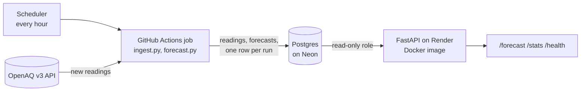
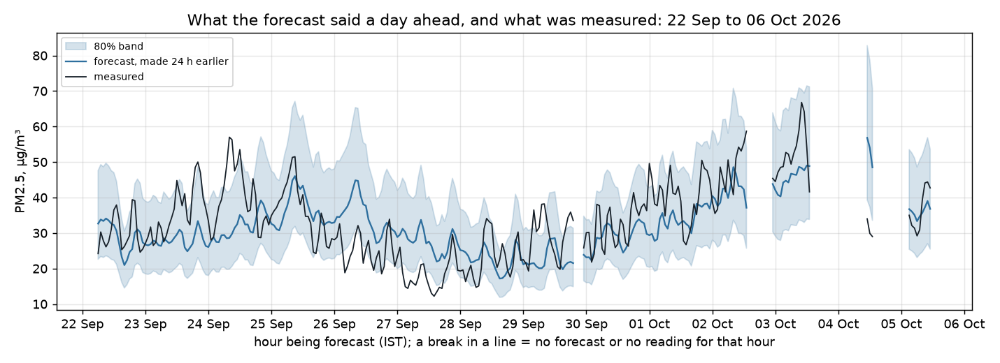
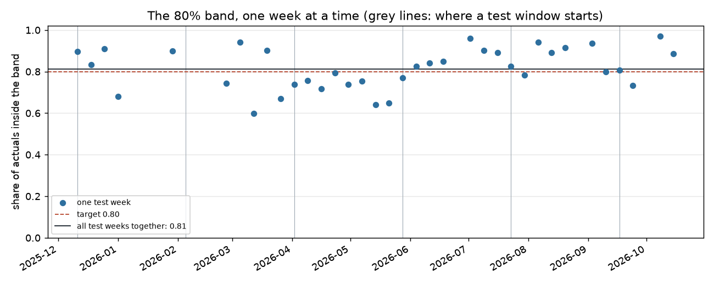
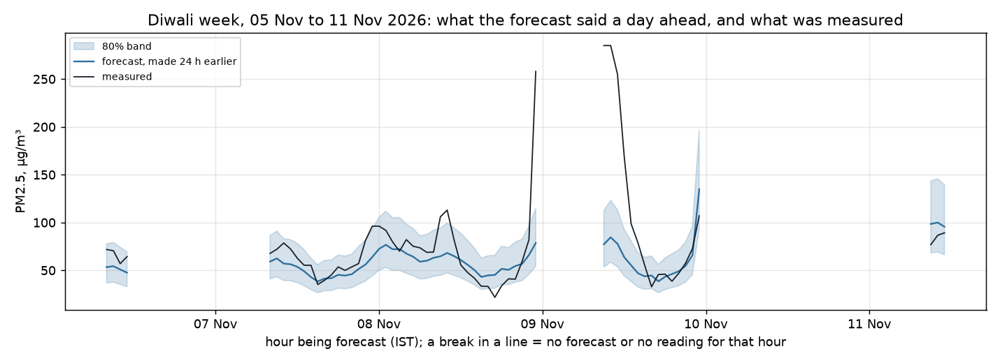

# pune-aqi — PM2.5 forecasts for Pune, 24 hours ahead, running live

[](https://github.com/vaibhavpanchal9/pune-aqi/actions/workflows/ci.yml)

Every hour this project collects PM2.5 readings from 13 air-quality stations around Pune, forecasts
the next day for one of them with a range around each number, stores every forecast before the actual
is known, and serves it through a public API.

**Live API:** https://pune-aqi-api.onrender.com/docs (free hosting: the first request after a quiet
spell can take up to a minute)

| | |
|---|---|
| **Data** | 150,000+ hourly readings since February 2025 from 13 reference-grade stations (CPCB / MPCB / IITM), through OpenAQ. Collected every hour, unattended, since 26 October 2026. |
| **Model** | Ridge regression on the station's own past: lags, rolling means, time of day and season. 24 hours ahead, with an 80% band. |
| **Accuracy** | 7.3% better than "same as now" over 48 test weeks (MAE 8.91 against 9.61 µg/m³). The 80% band held 81% of the actuals. |
| **Live record** | Each forecast is written once and scored when the actual arrives. The running record is public at `/stats`. |
| **Engineering** | PostgreSQL, FastAPI, Docker, CI on every code push, about 170 automated tests, 35 of them against a real Postgres. |

Where the model loses is in this README too: [Where it loses](#where-it-loses).

## How it works



1. **Collect.** `ingest.py` asks OpenAQ for the last 72 hours of every station and saves what is new.
   The primary key throws away what is already there, so the job can run as often as it likes. Every
   run leaves a row in `ingestion_runs`, and `healthcheck.py` tells "our job broke" from "the source
   is late".
2. **Forecast.** `forecast.py` builds the features for the newest hours and applies the model file
   `models/v2.json`. Each new reading gives one forecast for the same hour of the next day. The
   station's data arrives about 4 hours late, so about 20 hours of forecasts are always ahead of the
   clock.
3. **Store.** A forecast is written once. A later run cannot change it, so the live accuracy is the
   accuracy of what was really said at the time.
4. **Serve.** `app.py` reads the database through a role that can only read.

## Try it

```bash
curl https://pune-aqi-api.onrender.com/forecast    # the hours ahead: point, lower, upper, issued when
curl https://pune-aqi-api.onrender.com/stats       # how the forecasts already made have turned out
curl https://pune-aqi-api.onrender.com/health      # is the pipeline alive, is the data fresh
```

Every field is described in [docs/api.md](docs/api.md).

## Results

Every number in this section comes from one frozen data file: 10,225 usable hours of the
Panchawati_Pashan station through 11 November 2026. The run of all eight evaluation scripts on it is
kept whole in [results/frozen_run_2026-11-11.txt](results/frozen_run_2026-11-11.txt), and the later
checks use the same file.

**How it was tested.** Walk-forward: train on everything before a window, test on the next 8 weeks,
six times over, with a 24-hour gap between the two. That is 48 weeks, 11 December 2025 to
11 November 2026, and 5,532 forecasts the model had never seen. The score is MAE, the average size of
the error in µg/m³. The yardstick is persistence: "tomorrow at this hour = now".

### The model against simpler and fancier ones

Mean MAE over the six test windows, best first ([results/model_comparison.csv](results/model_comparison.csv)):

| Forecaster | MAE |
|---|---|
| **Ridge regression, all 21 features** | **8.91** |
| Ridge without the calendar features | 8.96 |
| Average of ridge and gradient boosting | 9.10 |
| Persistence (the yardstick) | 9.61 |
| Gradient boosting, best of five variants | 9.73 |
| Mean of the last 24 hours | 11.01 |
| Usual value for that month and hour | 11.66 |
| Same hour last week | 13.63 |

A straight line through the lags beats every gradient-boosting variant here. Trees cannot go beyond
the values they were trained on, and the winter window is higher than the months before it: there
boosting scored up to 21.85 where persistence scored 15.98.

| Test window | Ridge | Persistence |
|---|---|---|
| 1: 11 Dec to 3 Feb (winter) | 16.27 | **15.98** |
| 2: 5 Feb to 1 Apr | **9.76** | 10.70 |
| 3: 2 Apr to 27 May | **8.57** | 9.84 |
| 4: 28 May to 22 Jul | **4.73** | 5.21 |
| 5: 23 Jul to 16 Sep | **4.47** | 5.29 |
| 6: 17 Sep to 11 Nov | **9.66** | 10.66 |
| Mean | **8.91** | 9.61 |

### The band

A forecast of 60 is more useful as "60, and between 45 and 85 eight times out of ten". The band is a
share of the forecast, so it is narrow on a clean day and wide on a bad one. Its two edges come from
the model's relative errors on the 8 weeks before it was fitted
([results/intervals.csv](results/intervals.csv)).

| Band | Share of actuals inside (target 0.80) | Worst and best test window |
|---|---|---|
| **Share of the forecast (used)** | **0.814** | 0.721 to 0.871 |
| Fixed width | 0.791 | 0.522 to 0.964 |
| Quantile regression | 0.701 | 0.600 to 0.786 |



The picture is an ordinary fortnight from the newest test window, 22 September to 6 October 2026. It
was chosen by a rule and not by eye: the most recent 14 days in which at least 80% of the hours have a
forecast. On it the MAE is 7.51 against 8.21 for persistence, and 77% of the actuals are inside the
band. A break in a line is an hour with no forecast or no reading.

Three later checks, all kept in the repo:

- **Would sizing the band from more recent errors be better?** Eight ways were compared under a rule
  written down before the numbers were seen. None earned a switch
  ([results/band_calibration.csv](results/band_calibration.csv)).
- **Is the band the right width at every level?** No. It is a share of the forecast, and in bad air
  that makes it wider than it needs to be. Of the forecasts made at 90 µg/m³ or more it held 94% of
  the actuals; of those made under 30, 79% ([results/error_direction.csv](results/error_direction.csv)).
- **How far can one week stray?** Over the year the band holds 0.81, but 5 of 36 single test weeks
  were under 0.70, and 1 of 19 fortnights ([results/band_weekly.csv](results/band_weekly.csv)).



### When the data has holes

The full model needs a complete week of history, and on its first live day one gap silenced it for a
day. Two smaller models now stand behind it: one needs 24 hours of history, one needs 3. The richest
model whose inputs are all there makes the forecast, and each forecast records which one it was
([results/tier_availability.csv](results/tier_availability.csv),
[results/tier_comparison.csv](results/tier_comparison.csv)).

| Models allowed | Test hours with a forecast |
|---|---|
| Full only | 73.3% |
| Full, then the 24-hour model | 85.5% |
| Full, then 24-hour, then 3-hour | 90.6% |

The extra hours cost nothing in accuracy: MAE 8.59 with all three, against 8.60 for the full model on
its own hours. On the hours only they could serve, both smaller models still beat persistence (7.89
against 9.08, and 10.15 against 10.67).

### Where it loses

- **Winter.** In the winter test window the ridge does not beat persistence (16.27 against 15.98), and
  in January it loses.
- **Bad-air hours.** In the hours that turned out at 90 µg/m³ or more, the ridge is worse than
  persistence (27.47 against 22.99, [results/error_analysis.csv](results/error_analysis.csv)), and the
  80% band holds 74% of the actuals ([results/error_direction.csv](results/error_direction.csv)).
  These are 253 of the 5,532 test hours, 4.6%, and they are the hours people care about most.
- **No weather.** The model sees only past PM2.5 and the calendar. When the level jumps or drops from
  one day to the next, it cannot see that coming.
- **One station.** 13 stations are collected; one is modelled.
- **An untested month.** Six 8-week windows cover 48 weeks. 12 November to 10 December has never been
  a test window.

The week of Diwali 2026 shows the second and third points in one picture. On Monday 9 November at
09:00, the morning after Diwali night, the station read 285 µg/m³. The forecast made a day earlier
said 77, with a band reaching up to 113. The model can only react once a spike is in its own inputs,
and that is a day too late. The breaks are real holes: only 62 of that week's 168 hours have both a
forecast and a reading.



**Why it loses there.** The model bets that bad air will ease. After a reading of 90 µg/m³ or more
(106 on average) it forecasts 91, and the next day came in at 95.5. With "bad" meaning 90 or more,
three things can happen ([results/error_direction.csv](results/error_direction.csv)):

| When the forecast was made → a day later | Hours | Ridge MAE | Persistence MAE | Actuals inside the 80% band |
|---|---|---|---|---|
| Bad air → cleared | 102 | **16.4** | 31.1 | 96% |
| Bad air → still bad | 148 | 19.9 | **15.1** | 93% |
| Not bad yet → bad air | 105 | 38.1 | **34.1** | 49% |

The first two rows are every forecast made in bad air, and over them the bet pays: 18.5 against 21.6.
The last two are the hours that turned out bad, and over them it does not: 27.5 against 23.0. When a
bad spell arrives, neither forecaster sees it coming: all 105 forecasts were too low, from both, and
half of the actuals were above the band.

Winter is a second problem. In that test window the ridge ran about 5 µg/m³ low whatever level it
started from. With that average error taken out it is level with persistence (15.9 against 16.0), so
the offset accounts for the whole loss. It was the model's first winter, and that may be the reason:
the training data ran from late February to early December. But the autumn window, a time of year the
model had seen, ran 4 low as well, so this is not settled.

## The live record

The numbers above are a replay of the past. The live record is the forecasts the running service
actually issued, each stored before its hour arrived.

On 22 November 2026, for the model that has been live since 13 November:

- **198 scored hours of the full model:** MAE 16.05 against 16.89 for persistence.
- **The band:** 72% of actuals inside, against a target of 80%. After the first week it was 66%: three
  days when the level swung by about 20 µg/m³ held most of the misses.
- **Availability:** a forecast for every hour of the last 7 days (168 of 168).

The current numbers are always at
[/stats](https://pune-aqi-api.onrender.com/stats). The reasoning behind each step is in
[docs/decisions.md](docs/decisions.md).

## How it is built

- **Loads that are safe to repeat.** The key of a reading is (sensor, hour, source), and inserts skip
  what exists. Re-running a job, or a backfill that crashed halfway, cannot create duplicates.
- **The model is a file of numbers.** `models/v2.json` holds the scaler and the coefficients.
  `forecast.py` applies them with NumPy, and the result is checked against scikit-learn when the file
  is written. Model files are never overwritten: a new model is a new version.
- **Forecasts are write-once.** The key of a forecast is (sensor, target hour, model version).
- **Least privilege.** The API connects with a database role that can only read.
- **One image, tested as it is built.** The Docker build runs the API tests; if they fail there is no
  image.
- **Measured with two clocks.** The server answers in about 1 ms when the answer is in its cache and in
  38 to 62 ms when it asks the database. From Pune a request takes about 125 ms end to end, p95 under
  290 ms ([results/latency_2026-11-23.csv](results/latency_2026-11-23.csv)). On free hosting the first
  request after a quiet spell also waits for the server to wake: 17.5 seconds when measured.
- **CI on every code push.** Lint, the whole test suite on Python 3.12 and 3.14 with a Postgres started
  for the job, a coverage floor, and the image build ([docs/testing.md](docs/testing.md)).
- **A written trail.** Every decision is dated and explained in
  [docs/decisions.md](docs/decisions.md), including the ones that turned out wrong.

## Run it

```bash
python3 -m venv .venv && source .venv/bin/activate
pip install -r requirements.txt
cp .env.example .env                 # fill in OPENAQ_KEY and DATABASE_URL
python apply_schema.py && python ingest.py --discover && python backfill.py
python healthcheck.py
```

Then:

```bash
python dataset.py                    # the feature file for the primary station
python train.py                      # every model and baseline on the six test windows
python forecast.py --dry-run         # what the hourly job would write, without writing it
uvicorn app:app --reload             # the API at http://127.0.0.1:8000/docs
python -m pytest -q                  # the tests that need no database
```

The API with a local Postgres in Docker: [docs/docker.md](docs/docker.md). The database tests:
[docs/testing.md](docs/testing.md).

## What is where

| Part | Files |
|---|---|
| Collect | `openaq_client.py`, `transform.py`, `ingest.py`, `backfill.py`, `db.py`, `schema.sql`, `healthcheck.py` |
| Know the data | `quality_report.py`, `audit_sensors.py`, `runsql.py`, `sql/` |
| Build and judge models | `dataset.py`, `splits.py`, `baselines.py`, `evaluate.py`, `train.py`, `error_analysis.py`, `intervals.py`, `tiers.py`, `band_calibration.py`, `band_weekly.py`, `error_direction.py` |
| Ship the model | `fit_model.py`, `modelfile.py`, `models/`, `forecast.py` |
| Serve | `service.py`, `app.py`, `Dockerfile`, `docker-compose.yml`, `render.yaml`, `make_readonly_role.py`, `seed_local.py`, `bench.py` |
| Check | `tests/`, `.github/workflows/ci.yml` |
| Run on a schedule | `.github/workflows/ingest.yml` |
| Record | `docs/`, `results/`, `figures/`, `readme_figures.py` |

Documents: [decisions](docs/decisions.md) · [runbook](docs/runbook.md) · [API](docs/api.md) ·
[Docker](docs/docker.md) · [deployment](docs/deploy.md) · [testing](docs/testing.md) ·
[weekly notes](docs/notes/)

---

Built by [Vaibhav Panchal](https://github.com/vaibhavpanchal9), October to November 2026.
Data: OpenAQ (CC BY 4.0); original measurements by CPCB, MPCB and IITM.
